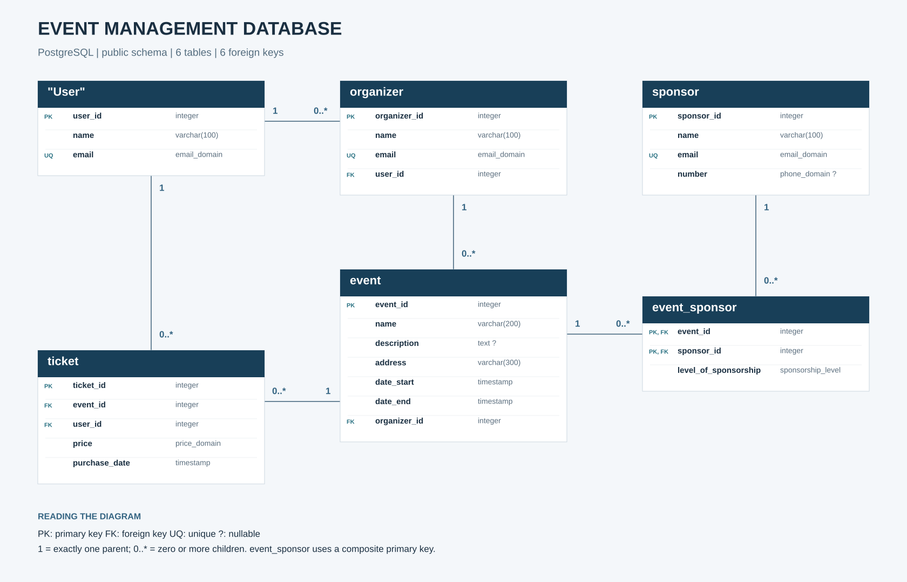

# Event Management Database

A PostgreSQL learning project for managing events, organizers, sponsors, users, and ticket purchases. The schema demonstrates relational modeling, data validation with domains and constraints, reporting views, and PL/pgSQL procedures.

The repository contains the original schema-only export plus synthetic demo data and example queries. It does not include an application or a payment integration.



## Features

- Six related tables with primary keys and foreign keys.
- A many-to-many relationship between events and sponsors, with a sponsorship level on each association.
- Reusable domains for email, phone, non-negative prices, and sponsorship levels.
- Validation of event dates, non-empty event names, and ticket purchase dates.
- Two views and one materialized view for reporting and selected user fields.
- Two PL/pgSQL procedures demonstrating ticket insertion, exception handling, and cursor iteration.

## Repository contents

```text
.
├── README.md
├── schema.sql              # Original pgAdmin export; no table data
├── demo_data.sql           # Fictional records for a fresh database
├── queries.sql             # Read-only SQL examples
├── verify.sql              # Read-only checks for the demo dataset
├── .gitignore
└── docs/
    ├── er-diagram.svg      # Scalable diagram displayed above
    ├── er-diagram.png      # Image for previews and presentations
    └── er-diagram.mmd      # Editable Mermaid ER diagram
```

## Quick start

Use **PostgreSQL 18** and its `psql` command-line client. The export records a PostgreSQL 18.3 source server and pg_dump 18.6. Compatibility with older major versions is not assumed.

Start your local PostgreSQL server, open a terminal in this repository, and run:

```bash
createdb -T template0 event_management_demo
psql -X -v ON_ERROR_STOP=1 --single-transaction -d event_management_demo -f schema.sql
psql -X -v ON_ERROR_STOP=1 -d event_management_demo -f demo_data.sql
psql -X -v ON_ERROR_STOP=1 -d event_management_demo -f verify.sql
psql -X -v ON_ERROR_STOP=1 -d event_management_demo -f queries.sql
```

These commands use your local connection defaults. If needed, add `-h localhost -p 5432 -U YOUR_POSTGRES_ROLE` to each command. Replace the role placeholder with your PostgreSQL username. Do not put passwords in the repository.

Use a **new, empty database**. `schema.sql` is intended to run once, and `demo_data.sql` refuses to load into non-empty project tables. It inserts all demo records in one transaction.

The dump includes `\restrict` and `\unrestrict`, which are `psql` commands. Run the complete dump with `psql` as shown above, rather than pasting it into pgAdmin's Query Tool. After restoration, connect pgAdmin to `event_management_demo` to inspect the tables and run the example `SELECT` queries.

## Data model

All tables are in the `public` schema. IDs are integers; five entity IDs use sequence-backed defaults. The junction table has a composite primary key.

| Table | Purpose | Key and relationships |
| --- | --- | --- |
| `"User"` | User names and email addresses | `user_id` PK; unique email |
| `organizer` | Organizer profiles linked to users | `organizer_id` PK; `user_id` FK; unique email |
| `event` | Event details, location, and dates | `event_id` PK; `organizer_id` FK |
| `sponsor` | Sponsor contact information | `sponsor_id` PK; unique email |
| `event_sponsor` | Sponsorship associations and levels | Composite PK `(event_id, sponsor_id)`; both columns are FKs |
| `ticket` | Ticket purchases and recorded prices | `ticket_id` PK; `event_id` and `user_id` FKs |

A user can have multiple organizer profiles: `organizer.user_id` is **not unique**. Every organizer, event, and ticket must reference its parent records, while parent records may have zero children. A user may buy multiple tickets for the same event.

`"User"` is a quoted, case-sensitive table name. Write `public."User"` in SQL.

### Validation rules

| Domain / constraint | Behavior |
| --- | --- |
| `email_domain` | `varchar(100)` with an email-format regular expression |
| `phone_domain` | `varchar(20)` with a phone-format regular expression; sponsor phone is optional |
| `price_domain` | `numeric(10,2)` greater than or equal to zero |
| `sponsorship_level` | One of `головний`, `преміальний`, `звичайний` |
| Event dates | `date_end > date_start` |
| Event name | Cannot be empty after trimming |
| Ticket purchase date | Cannot be later than `now()` when the row is checked |

Format checks do not verify whether an email address or phone number exists. Prices have no stored currency. Date columns use `timestamp without time zone`.

## Views and procedures

| Object | Type | Behavior |
| --- | --- | --- |
| `event_ticket_stats` | View | Ticket count, total revenue, and average price per event; includes events without tickets |
| `public_users` | View | Exposes `user_id` and `name`, omitting email |
| `event_sponsors_info` | Materialized view | Stores joined event and sponsor details |
| `buy_ticket(integer, integer, numeric, text)` | Procedure | Attempts to insert a ticket and returns an INOUT status of `success` or `error` |
| `count_tickets_per_event()` | Procedure | Iterates through ticket counts using a cursor and emits `NOTICE` messages |

The materialized view is created with `WITH NO DATA`. Populate it after loading records and refresh it when event or sponsor information changes:

```sql
REFRESH MATERIALIZED VIEW public.event_sponsors_info;
SELECT * FROM public.event_sponsors_info;
CALL public.count_tickets_per_event();
```

`demo_data.sql` performs the initial refresh. `count_tickets_per_event()` reports only events that have tickets; the reporting view also includes zero-ticket events. For these events, the original reporting view returns `NULL` for revenue and average price; the examples use `COALESCE` where appropriate.

## Demo dataset and queries

The seed creates **5 users, 2 organizers, 3 events, 3 sponsors, 4 sponsorship links, and 5 tickets**. Names and contact details are fictional; email addresses use `example.com`. Event dates are relative to the load time.

Expected ticket report immediately after loading:

| Event | Tickets | Total revenue |
| --- | ---: | ---: |
| Python Community Meetup | 3 | 700.00 |
| SQL Practice Workshop | 2 | 600.00 |
| Open Source Evening | 0 | 0.00 with `COALESCE` |

`queries.sql` demonstrates joins, aggregation, `HAVING`, `NOT EXISTS`, a ranking window function, reporting views, and XML generation. `verify.sql` displays expected and actual counts, revenue, and a final PASS/FAIL result. It is intended for the unchanged demo dataset.

## Current limitations

This is an educational schema. The original export is preserved unchanged.

- `buy_ticket` uses `SELECT COUNT(*) INTO STRICT` for the event lookup. An aggregate count returns a row even when no event exists, so the `NO_DATA_FOUND` branch does not detect that case. The foreign key rejects the insert, and the generic handler returns `error` instead. Callers must inspect the returned status.
- Procedures use unqualified table names; their execution requires `public` on the session's `search_path`.
- `organizer.user_id` has `ON DELETE CASCADE`. Other foreign keys use the default `NO ACTION`, so related events or tickets can prevent deleting a user or organizer.
- There is no seat capacity, payment processing, cancellation workflow, or application authentication. `public_users` alone is not an access-control policy.

Possible next steps include improving the procedure's event lookup and error handling, adding query-driven indexes on foreign keys, and exposing the database through a Django application.

## References

- [PostgreSQL: restoring SQL dumps](https://www.postgresql.org/docs/18/backup-dump.html)
- [PostgreSQL: PL/pgSQL statements and STRICT](https://www.postgresql.org/docs/18/plpgsql-statements.html)
- [GitHub: Mermaid diagrams](https://docs.github.com/en/get-started/writing-on-github/working-with-advanced-formatting/creating-diagrams)

## Author

[Oleksii Ivaniuk](https://github.com/ivaniuk07) · Computer Science student, Ivan Franko National University of Lviv.
